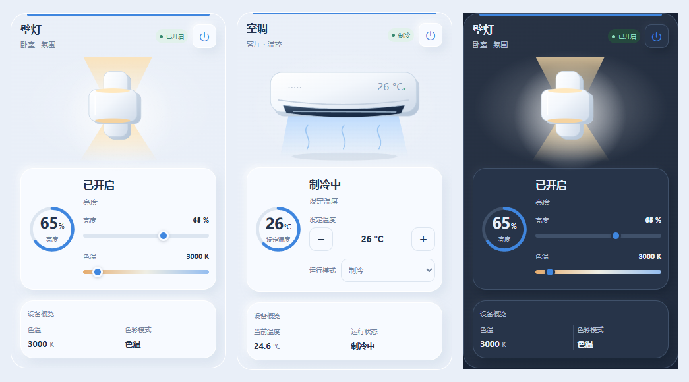

# Soft Home · 柔光设备卡片

按已确认的浅蓝白设计制作的 Home Assistant Lovelace 自定义卡片。19 种设备插画、中文可视化编辑器、深浅主题、真实实体读数与操作。

**安装只需要一个文件：`dist/soft-home-card.js`。无需 button-card、Mushroom、card-mod、CDN 或额外图片文件。**

## HACS 安装（推荐）



[GitHub 最新版本](https://github.com/maycode0-0/soft-home-card/releases/latest) · [自动检查](https://github.com/maycode0-0/soft-home-card/actions)

1. 打开 Home Assistant → HACS → 右上角菜单 → **自定义仓库**。
2. 仓库填写 `https://github.com/maycode0-0/soft-home-card`，类型选择 **Dashboard（仪表盘）**。
3. 搜索 **Soft Home · 柔光设备卡片**，下载最新版本。
4. 检查“设置 → 仪表盘 → 资源”中是否已注册资源。若未自动添加，添加 URL `/hacsfiles/soft-home-card/soft-home-card.js`，类型为 **JavaScript 模块**。
5. 刷新仪表盘，编辑 → 添加卡片，搜索 **Soft Home**，选择设备外观和实体后保存。

从手动安装迁移时，先把原先 `/local/soft-home-card/soft-home-card.js` 的资源注册移除，保留 HACS 的资源注册。不要同时注册两个版本。原来的卡片配置和实体绑定可以保留。

**以后更新：**在 HACS 中安装新版本，再刷新浏览器或 Companion App。更新后若仍显示旧版，清除前端缓存。使用 YAML 管理仪表盘资源时，需要自行把 URL 改成上面的 `/hacsfiles/` 路径。

## 手动安装（可选）

1. 从 [Releases](https://github.com/maycode0-0/soft-home-card/releases/latest) 下载 `soft-home-card.js`，或使用仓库的 `dist/soft-home-card.js`。
2. 将文件放到 HA 配置目录的 `www/soft-home-card/soft-home-card.js`（常见完整路径为 `/config/www/soft-home-card/soft-home-card.js`）。
3. 在仪表盘资源中添加 `/local/soft-home-card/soft-home-card.js?v=1.1.0`，类型选择 **JavaScript 模块**。
4. 刷新后添加 Soft Home 卡片，在可视化编辑器里选择实体。

若“资源”入口不可见，先在个人资料中开启高级模式。首次创建 `www` 目录后如出现 404，重启 HA 再访问。手动升级时替换 JS 并更新 URL 的版本参数。

## 在编辑器里配置

1. **设备类型**：选择洗衣机、空调等 19 种类型之一。
2. **具体设备**：列表按类型筛选，可搜索设备名称、型号或实体 ID。家里有多台洗衣机会分别列出。
3. **主实体与参数**：选定设备后，所有实体选择器只列出该设备关联的实体。输入中文名称或实体 ID 搜索；方向键选择，回车确认，Esc 关闭，× 清除。

例如：选择「洗衣机」→「阳台洗衣机」→ 展开「读数与参数」→ 在「剩余时间 / 主读数」输入“剩余”并选择对应传感器。无需收集全屋实体 ID 或手写 YAML。

设备分类根据设备和实体名称、型号识别。找不到时勾选 **「搜索全部设备手动绑定」**，搜索并选择实际设备；后续参数仍只显示这台设备的实体。优先使用 HA 设备注册表关联；若集成没有设备关联，会按稳定数字标识分组，其余实体单独列出，避免混入其他设备。

切换类型或具体设备会清空旧主实体、读数、辅助操作、概览与高级 actions，请重新选择对应参数。普通名称、主题等修改保留已有高级配置。

- **主实体**：提供主要状态和自动控件，例如浴霸可选择该设备的 climate、fan 或 switch 实体。
- **名称、房间、主题、强调色**：可选。浅色默认延续设计稿。
- **主读数**：可选其他实体或主实体属性。洗衣机可选剩余时间传感器。
- **辅助读数**：例如温湿度计的湿度实体、冰箱冷冻温度实体。
- **功率、进度**：可选功率传感器和 0–100 的进度传感器。没有数据时不会填入演示值。
- **辅助操作**：最多 3 个实体，可绑定洗衣启动按钮、除雾开关、换气开关、取水按钮或脚本。
- **底部概览**：最多 3 项实体/属性。不指定时显示主实体已有的属性。
- **只读展示**：保留读数和详情入口，禁用服务操作。

卡片通过当前登录的 HA 会话调用服务，不保存凭据。设备需要先通过对应集成接入 Home Assistant；卡片不提供新的设备集成。

## 19 种外观

| `device` | 设备 | 常见主实体 |
| --- | --- | --- |
| `washing_machine` | 洗衣机 | `sensor` / `switch` |
| `dryer` | 烘干机 | `sensor` / `switch` |
| `projector` | 投影仪 | `media_player` / `switch` |
| `projector_lift` | 投影仪升降支架 | `cover` |
| `screen` | 幕布 | `cover` |
| `air_conditioner` | 空调 | `climate` |
| `refrigerator` | 冰箱 | `sensor` / `number` |
| `integrated_stove` | 集成灶 | `fan` / `sensor` / `switch` |
| `water_heater` | 热水器 | `water_heater` / `climate` |
| `floor_heating` | 地暖 | `climate` |
| `wall_light` | 壁灯 | `light` |
| `spotlight` | 射灯 | `light` |
| `downlight` | 筒灯 | `light` |
| `pendant_light` | 吊灯 | `light` |
| `led_strip` | 灯带 | `light` |
| `tea_machine` | 茶吧机 | `sensor` / `number` / `switch` |
| `bathroom_mirror` | 浴室镜 | `light` / `switch` |
| `temperature_humidity` | 温湿度计 | `sensor` |
| `bathroom_heater` | 浴霸 | `climate` / `fan` / `switch` |

## 自动控件

控件同时检查实体能力、服务是否存在、连接状态和只读配置。`unknown`、`unavailable` 或实体不存在时不会发送控制命令。

| 实体域 | 可用控件 |
| --- | --- |
| `light` | 开关；支持时显示亮度、Kelvin 色温 |
| `climate` | 支持时显示设定温度、HVAC 模式、开关 |
| `water_heater` | 支持时显示目标温度、运行模式、开关 |
| `cover` | 支持时显示上升、停止、下降、位置百分比 |
| `media_player` | 支持时显示音量和开关；详情中使用其他播放功能 |
| `fan` | 开关；支持时显示风速百分比 |
| `switch` / `input_boolean` | 开关 |
| `number` / `input_number` | 按实体上下限和步长调节数值 |
| `select` / `input_select` | 选择实体提供的选项 |
| `button` / `input_button` | 执行按钮 |
| `sensor` / 其他 | 只读状态与 HA 原生详情入口 |

**幕布与支架的位置语义：**HA 标准 `current_position` 是 0=关闭、100=开启。默认直接显示“开启程度”。选择“反转行程读数”后显示 `100 − current_position`，拖动也反向换算；适用于“关闭=幕布落下”的集成。上升/下降始终调用 `open_cover`/`close_cover`，不会调换电机命令。以实际集成定义为准。

光源不支持亮度或色温时，相应滑条不会出现。双设定点温控器不显示单温度按钮，可进入 HA 原生详情使用上下限温度。RGB 颜色选择、历史曲线及所有设备特有功能不在此版本的自动控件范围内；可通过详情或辅助实体操作。

## 少量 YAML 示例（可选）

通常用可视化编辑器即可，以下仅用于了解配置结构。

```yaml
type: custom:soft-home-card
device: wall_light
entity: light.replace_with_your_entity
name: 壁灯
room: 卧室
```

一个包含环境读数的卡片：

```yaml
type: custom:soft-home-card
device: temperature_humidity
entity: sensor.replace_with_your_temperature
secondary_entity: sensor.replace_with_your_humidity
```

仅高级自定义服务需要代码编辑器。例如将“开始洗衣”连接到已有脚本：

```yaml
type: custom:soft-home-card
device: washing_machine
entity: sensor.replace_with_your_washer_state
primary_entity: sensor.replace_with_your_remaining_time
primary_label: 剩余时间
actions:
  - label: 开始洗衣
    action: perform-action
    perform_action: script.turn_on
    target:
      entity_id: script.replace_with_your_start_script
```

`actions` 最多 3 项，支持 `perform-action` 和 `more-info`。服务参数放在 `data`，目标放在 `target`；没有目标时不会擅自使用主实体。可用 `confirmation: "确定执行？"` 为特定操作开启确认。编辑器修改普通字段时保留高级 `actions` 配置。

编辑器自动保存 `device_id`（无注册表关联时保存 `entity_group`）用于恢复设备范围，已有 YAML 仍可直接使用。

主要可选配置：`primary_attribute`、`primary_unit`、`secondary_entity`、`power_entity`、`progress_entity`、`metrics`、`auxiliary`、`show_stats`、`read_only`、`invert_position`、`theme`、`accent`。`metrics` 项支持 `entity`、`attribute`、`name`、`unit`、`precision`；`auxiliary` 项支持 `entity`、`name`。

## 开发与验证

需要 Node.js 22 和 npm。仓库已经包含全部源码、插画和锁文件，安装到 HA 的卡片没有运行时依赖。

```sh
npm ci
npm run build
npm run check
npm test
npx playwright install chromium
npm run test:browser
npm run demo
```

本地预览地址为 `http://127.0.0.1:8124`，全部操作使用模拟实体。浏览器测试也可通过 `SOFT_HOME_PLAYWRIGHT` 指定本机 Playwright 模块，通过 `SOFT_HOME_CHROMIUM` 指定浏览器路径。

- `src/`：卡片、可视化编辑器、数据和操作逻辑。
- `assets/devices/`：19 个可编辑 SVG 插画，构建时嵌入 JS。
- `dist/soft-home-card.js`：提交到仓库的 HACS 安装文件；修改源码后必须重新构建。
- `demo/` 和 `test/`：交互预览、逻辑测试和浏览器测试。
- `hacs.json`：HACS 安装元数据。

## 发布新版本

1. 更新 `package.json` 版本，并运行 `npm install --package-lock-only` 同步锁文件。
2. 在 `CHANGELOG.md` 添加对应版本说明；更新手动安装示例的版本参数。
3. 运行 `npm run build && npm run check && npm test && npm run test:browser`。
4. 将源码、版本信息、锁文件和 `dist/soft-home-card.js` 一起提交并推送。
5. 创建与版本一致的标签，例如 `git tag v1.1.0`，再执行 `git push origin v1.1.0`。

GitHub Actions 会重新构建并检查提交的 JS 是否一致，运行逻辑测试与 Chromium 交互测试。全部通过后才创建 GitHub Release，附上 `soft-home-card.js` 和 `SHA256SUMS`。HACS 根据 Release 显示更新。工作流只使用 GitHub 自带的 `GITHUB_TOKEN`，不需要配置个人令牌。

CI 只对主分支和拉取请求运行检查；发布只由 `v*` 标签触发。GitHub Action 版本固定到提交 SHA，并由 Dependabot 提议更新。主分支也能在 HACS 中下载，日常安装推荐选择正式 Release。

## 验证范围

实现了 Home Assistant 自定义卡片接口 `setConfig`、`hass`、`getCardSize`、`getGridOptions`、`getConfigElement`、`getStubConfig`、`config-changed` 和 `hass-more-info`。测试使用模拟 HA 会话，并不等同于全部实体集成的实机测试。

参考：
- https://developers.home-assistant.io/docs/frontend/custom-ui/custom-card/
- https://developers.home-assistant.io/docs/frontend/data/
- https://www.hacs.xyz/docs/publish/plugin/
