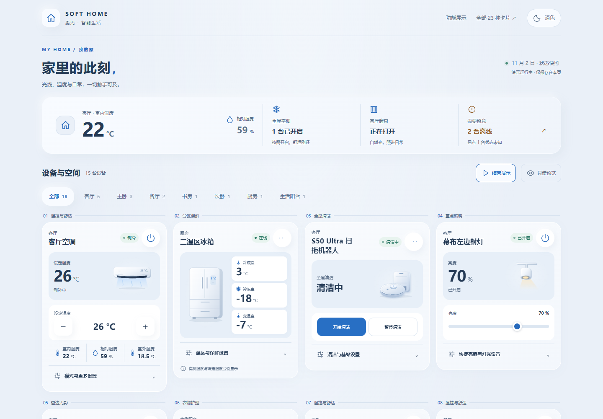
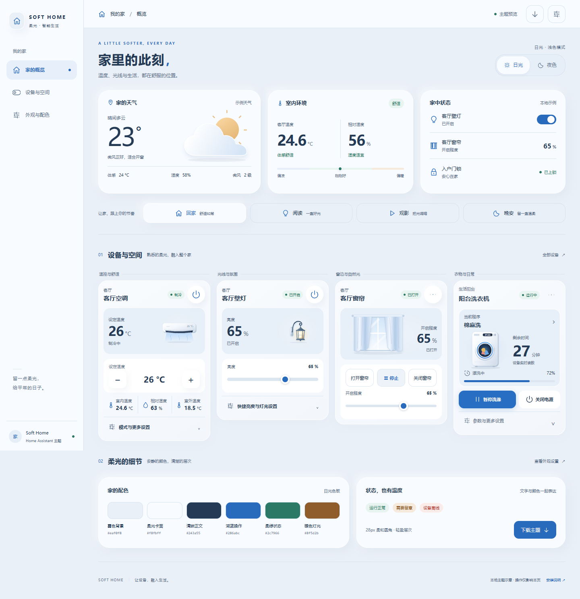
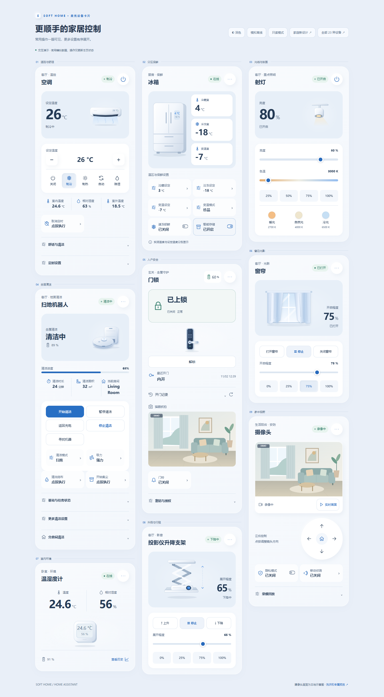
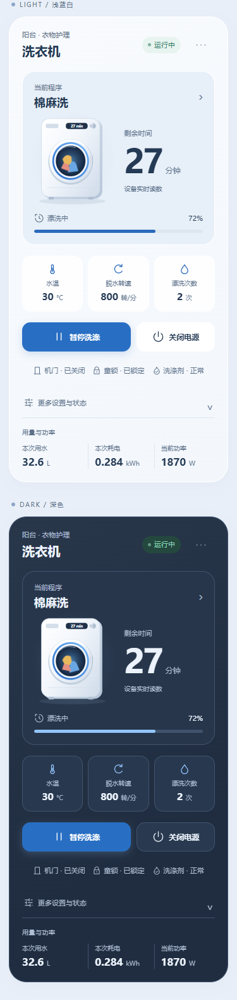

# Soft Home · 柔光设备卡片

按浅蓝白柔光设计制作的 Home Assistant Lovelace 自定义卡片。23 种设备插画、设备专属布局、中文可视化编辑器、深浅主题、真实实体读数与操作。

本次视觉更新统一了浅蓝白卡面、读数与插画布局、44px 常用操作触控区域，并增加离线与只读提示。执行 `npm run demo` 后打开 `http://127.0.0.1:8124/demo/home.html`，可按房间查看根据 Home Assistant MCP 状态快照制作的家庭预览，筛选需关注设备或切换深浅主题。

卡片默认采用紧凑布局：缩小设备插画和留白，温度、亮度、窗帘行程、启停等常用操作直接展示，其他参数折叠。桌面家庭预览为四列，窄屏自动减少列数。可在编辑器取消「紧凑布局」，或配置 `compact: false` 恢复舒展布局；实体绑定和运行动画沿用相同逻辑。

家庭预览中的名称与读数来自 2026-11-02 的 MCP 查询，预览使用本地示例实体和控制能力，操作只更新当前页面。安装到 Home Assistant 后，卡片通过配置中的真实实体 ID 读取状态并调用 HA 服务。实体 ID 和完整能力可以在已登录的 HA「工具 → 模板」或实体管理页核对；MCP 的状态接口本身未返回这些字段。洗衣机应绑定运行状态、启停、电源和剩余时间等对应实体，动画才能跟随实际运行状态。



运行中的设备会显示局部动画：洗衣 / 烘干滚筒、空调气流、清扫机器人、灯光光晕、加热热气，以及窗帘和升降设备的移动方向提示。动画跟随设备上报的状态，暂停、待机、关闭或离线时停止；屏幕外及后台自动暂停，并遵循系统“减少动态效果”设置。家庭预览页的「演示运行」只切换本地模拟状态。

**设备卡片安装只需要一个文件：`dist/soft-home-card.js`。无需 button-card、Mushroom、card-mod、CDN 或额外图片文件。**

## 配套全局主题

新增 **Soft Home · 柔光主题**：将浅蓝白卡面、圆角和柔光层次延伸到 HA 全局背景、侧边栏、原生卡片、表单和弹窗，包含浅色／深色两种模式。只需安装 [themes/soft_home.yaml](themes/soft_home.yaml)，无需额外插件。

[安装与使用说明](themes/README.md) · 本地预览：运行 `npm run demo` 后打开 `http://127.0.0.1:8124/demo/theme.html`。预览可切换日光／夜色并操作本地示例；页面排版为示意，主题不改变 HA 仪表盘布局。主题需单独复制安装，不随卡片的 HACS 安装自动启用。



## 可选：全局设备详情弹窗

新增独立扩展 [dist/soft-home-more-info.js](dist/soft-home-more-info.js)，将 HA 的标准实体详情入口转到 Soft Home 弹窗。空调圆盘改为柔光插画与温控布局，灯光、窗帘等常见实体也有配套详情。传感器与事件实体补回 HA 原生历史和活动组件，当前为“无”的开锁事件仍能查看过往记录。右上角齿轮打开「原生详情」，完整历史页、设置、要求 PIN 的门锁及特殊类型继续使用 HA 原生流程。

通过 `frontend.extra_module_url` 全局加载后，可从仪表盘、设置或实体列表打开；首次配置需要重启 HA。它与主题 YAML 分开安装，操作说明和兼容范围见 [全局详情安装说明](docs/more-info.md)。本地预览：`http://127.0.0.1:8124/demo/more-info.html`。

主灯／吊灯现使用六灯头大吊灯造型，温度和湿度详情通过 HA 原生历史组件显示各自的变化曲线。对应预览：[主灯](docs/more-info-main-light-preview.png)、[温度](docs/more-info-temperature-preview.png)、[湿度](docs/more-info-humidity-preview.png)。

童锁详情使用独立的按键保护样式，状态和按钮显示“开启／关闭童锁”；真实门锁保留门把手插画与上锁／解锁流程。[童锁预览](docs/more-info-child-lock-preview.png)。

## HACS 安装（推荐）



[GitHub 最新版本](https://github.com/maycode0-0/soft-home-card/releases/latest) · [自动检查](https://github.com/maycode0-0/soft-home-card/actions)

1. 打开 Home Assistant → HACS → 右上角菜单 → **自定义仓库**。
2. 仓库填写 `https://github.com/maycode0-0/soft-home-card`，类型选择 **Dashboard（仪表盘）**。
3. 搜索 **Soft Home · 柔光设备卡片**，下载最新版本。
4. 检查“设置 → 仪表盘 → 资源”中是否已注册资源。若未自动添加，添加 URL `/hacsfiles/soft-home-card/soft-home-card.js`，类型为 **JavaScript 模块**。
5. 刷新仪表盘，编辑 → 添加卡片，搜索 **Soft Home**，选择设备外观和实体后保存。

从手动安装迁移时，先把原先 `/local/soft-home-card/soft-home-card.js` 的资源注册移除，保留 HACS 的资源注册。不要同时注册两个版本。原来的卡片配置和实体绑定可以保留。

**以后更新：**在 HACS 中安装新版本，再刷新浏览器或 Companion App。更新后若仍显示旧版，清除前端缓存。使用 YAML 管理仪表盘资源时，需要自行把 URL 改成上面的 `/hacsfiles/` 路径。

## 手动安装（可选）

1. 从 [Releases](https://github.com/maycode0-0/soft-home-card/releases/latest) 下载 `soft-home-card.js`，或使用仓库的 `dist/soft-home-card.js`。
2. 将文件放到 HA 配置目录的 `www/soft-home-card/soft-home-card.js`（常见完整路径为 `/config/www/soft-home-card/soft-home-card.js`）。
3. 在仪表盘资源中添加 `/local/soft-home-card/soft-home-card.js?v=1.2.4`，类型选择 **JavaScript 模块**。
4. 刷新后添加 Soft Home 卡片，在可视化编辑器里选择实体。

若“资源”入口不可见，先在个人资料中开启高级模式。首次创建 `www` 目录后如出现 404，重启 HA 再访问。手动升级时替换 JS 并更新 URL 的版本参数。

## 在编辑器里配置

1. **设备类型**：选择洗衣机、空调等 23 种类型之一。
2. **具体设备**：列表按类型筛选，可搜索设备名称、型号或实体 ID。家里有多台洗衣机会分别列出。
3. **主实体与参数**：选定设备后，所有实体选择器只列出该设备关联的实体。输入中文名称或实体 ID 搜索；方向键选择，回车确认，Esc 关闭，× 清除。

例如：选择「洗衣机」→「阳台洗衣机」→ 展开「读数与参数」→ 在「剩余时间 / 主读数」输入“剩余”并选择对应传感器。无需收集全屋实体 ID 或手写 YAML。

设备分类根据设备和实体名称、型号识别。找不到时勾选 **「搜索全部设备手动绑定」**，搜索并选择实际设备；后续参数仍只显示这台设备的实体。优先使用 HA 设备注册表关联；若集成没有设备关联，会按稳定数字标识分组，其余实体单独列出，避免混入其他设备。

切换类型或具体设备会清空旧主实体、读数、辅助操作、概览与高级 actions，请重新选择对应参数。普通名称、主题等修改保留已有高级配置。

- **主实体**：提供主要状态和自动控件，例如浴霸可选择该设备的 climate、fan 或 switch 实体。
- **名称、房间、主题、强调色**：可选。浅色默认延续设计稿。
- **紧凑布局**：默认开启，次要参数折叠；取消后恢复完整展开布局。
- **主读数**：可选其他实体或主实体属性。洗衣机可选剩余时间传感器。
- **辅助读数**：例如温湿度计的湿度实体、冰箱冷冻温度实体。
- **功率、进度**：可选功率传感器和 0–100 的进度传感器。没有数据时不会填入演示值。
- **辅助操作**：最多 3 个实体，可绑定洗衣启动按钮、除雾开关、换气开关、取水按钮或脚本。
- **底部概览**：最多 3 项实体/属性。不指定时显示主实体已有的属性。
- **只读展示**：保留读数和卡片右上角的齿轮详情入口，禁用服务操作。

卡片通过当前登录的 HA 会话调用服务，不保存凭据。设备需要先通过对应集成接入 Home Assistant；卡片不提供新的设备集成。

## 洗衣机专用布局



洗衣机卡片直接展示洗涤程序、剩余时间、实际进度与启停。紧凑布局将温度、转速、机门、童锁、用量等收进「参数与更多设置」，洗涤剂不足、水温告警和故障仍置顶提示。关闭紧凑布局后，常用参数、安全状态与用量分别展开显示。

在编辑器里选定具体洗衣机后，会在**这台设备的实体范围内**按名称匹配参数；存在多个候选时保留为空。展开「洗衣机专属参数与操作」可修正或清除绑定。已有卡片可直接填写这些字段，也可重新选择具体设备触发匹配（重新选择会清空旧绑定）。

启停与电源分别调用所绑定实体的服务；参数、童锁及更多设置通过 HA 原生实体详情调整。卡片不猜测集成支持的程序或温度选项。未绑定的项目不显示；已绑定但未知的值显示 `—`；只有绑定真实进度传感器时才显示进度条。旧版 `primary_entity`、`secondary_entity`、`auxiliary`、`actions` 和 `metrics` 配置继续可用。

洗衣机实体保存在可选的 `washer` 对象中，例如：

```yaml
washer:
  program: select.your_washer_program
  phase: sensor.your_washer_phase
  temperature: select.your_washer_temperature
  spin_speed: select.your_washer_spin_speed
  rinse: number.your_washer_rinse_count
  power: switch.your_washer_power
  start: switch.your_washer_start_pause
  door: binary_sensor.your_washer_door
  child_lock: lock.your_washer_child_lock
  water_usage: sensor.your_washer_water_usage
  energy: sensor.your_washer_energy_consumption
```

执行 `npm run demo` 后，打开 `http://127.0.0.1:8124/demo/washer.html` 可比较深浅主题，以及运行中、待机、离线和告警状态。

## 设备专属布局

保留浅蓝白柔光风格，按设备用途组织信息：

| 设备 | 主卡片与展开区 |
| --- | --- |
| 空调 | 大号设定温度、模式、室内外温度与湿度；防霉、随身感、自清洁和定时收在展开区 |
| 冰箱 | 冷藏 / 冷冻 / 变温室实测温度；独立的温区设定、变温模式、速冻锁鲜、智能存储 |
| 灯具与浴室镜 | 亮度与色温滑条、快捷亮度、暖光 / 自然光 / 冷光；支持彩色的灯具显示颜色选择器 |
| 窗帘、幕布、投影支架 | 打开 / 停止 / 关闭、真实行程、快捷位置；无位置反馈时保留可用方向按钮 |
| 温湿度计 | 温度与湿度双读数、电量、历史详情 |
| 门锁 | 锁状态、门磁、防撬、电池、最近开门、按需加载近 7 天最多 20 条记录、猫眼抓拍；临时密码与授权实体入口 |
| 扫地机器人 | 清洁状态、进度、时间 / 面积 / 房间、启停回充；基站、回洗、烘干、地图及分房间参数展开显示 |
| 摄像头 | HA 代理预览图、实时画面入口、ONVIF 云台与可绑定的云台按钮；录像日期 / 时间与查询 / 播放 / 停止回放实体 |

在编辑器中选择具体设备后，展开「**设备专属功能与状态**」可修正自动匹配的实体。只匹配所选物理设备内唯一、名称明确且实体域相符的项目；多个候选时留空。已有卡片可手动绑定新增参数，或重新选择具体设备触发匹配（会清空旧绑定）。未绑定的实体功能不显示，未知值显示 `—`。

专属参数保存在可选的 `features` 对象中，例如：

```yaml
type: custom:soft-home-card
device: air_conditioner
entity: climate.living_room
features:
  indoor_temperature: sensor.ac_indoor_temperature
  outdoor_temperature: sensor.ac_outdoor_temperature
  humidity: sensor.ac_humidity
  drying: switch.ac_anti_mold
  self_clean: switch.ac_self_clean
```

开关、按钮、脚本直接操作所绑定实体，数值和选项参数打开 HA 原生详情调整。门锁仅在主实体为 `lock` 且服务可用时提供上锁 / 解锁；解锁需在卡片中确认，要求 PIN 的门锁使用 HA 原生详情。门锁历史依赖 HA Recorder 的历史 API 和当前用户权限；查询失败时显示详情入口。抓拍使用绑定的 `camera` / `image` 实体图片。

摄像头可在预览画面中央播放或暂停实时视频，优先使用 HA 的 `ha-camera-stream`。该组件未加载时，播放按钮会打开实体详情。录像查询、播放、临时密码和授权由具体集成提供，需绑定该设备已有的实体。回放日期与时间通过绑定实体的原生详情设置。卡片不包含厂商私有录像检索或独立授权管理功能。

通过 Home Assistant 的 ONVIF 集成接入 TP-IPC 等摄像头后，选中 ONVIF 摄像头主实体并开始实时预览，即可使用上、下、左、右方向键。默认点按后短时连续移动。若设备只支持相对移动，在「摄像头专属功能与状态」中切换「ONVIF 云台模式」，或在 YAML 中设置 `onvif_ptz: RelativeMove`。固定镜头可以将模式设为「关闭」。手动绑定的云台按钮或脚本优先执行。回到预置位使用单独绑定的按钮或脚本。

执行 `npm run demo` 后打开 `http://127.0.0.1:8124/demo/redesign.html`，可操作新的 9 类布局，切换深浅主题、离线和只读状态。演示图像为本地 SVG 示意图。

## 23 种外观

| `device` | 设备 | 常见主实体 |
| --- | --- | --- |
| `washing_machine` | 洗衣机 | `sensor` / `switch` |
| `dryer` | 烘干机 | `sensor` / `switch` |
| `projector` | 投影仪 | `media_player` / `switch` |
| `projector_lift` | 投影仪升降支架 | `cover` |
| `screen` | 幕布 | `cover` |
| `air_conditioner` | 空调 | `climate` |
| `refrigerator` | 冰箱 | `sensor` / `number` |
| `integrated_stove` | 集成灶 | `fan` / `sensor` / `switch` |
| `water_heater` | 热水器 | `water_heater` / `climate` |
| `floor_heating` | 地暖 | `climate` |
| `wall_light` | 壁灯 | `light` |
| `spotlight` | 射灯 | `light` |
| `downlight` | 筒灯 | `light` |
| `pendant_light` | 吊灯 | `light` |
| `led_strip` | 灯带 | `light` |
| `tea_machine` | 茶吧机 | `sensor` / `number` / `switch` |
| `bathroom_mirror` | 浴室镜 | `light` / `switch` |
| `temperature_humidity` | 温湿度计 | `sensor` |
| `bathroom_heater` | 浴霸 | `climate` / `fan` / `switch` |
| `curtain` | 窗帘 | `cover` |
| `door_lock` | 门锁 | `lock` / `sensor` |
| `vacuum` | 扫地机器人 | `vacuum` |
| `camera` | 摄像头（含云台） | `camera` |

## 自动控件

控件同时检查实体能力、服务是否存在、连接状态和只读配置。`unknown`、`unavailable` 或实体不存在时不会发送控制命令。

| 实体域 | 可用控件 |
| --- | --- |
| `light` | 开关；支持时显示亮度、Kelvin 色温、RGB 颜色 |
| `climate` | 支持时显示设定温度、HVAC 模式、风速、摆风、开关 |
| `water_heater` | 支持时显示目标温度、运行模式、开关 |
| `cover` | 支持时显示上升、停止、下降、位置百分比 |
| `media_player` | 支持时显示播放／暂停、上一首／下一首、停止、音量、静音、输入源与播放进度；没有音量读数也能使用播放控制 |
| `fan` | 开关；支持时显示风速百分比 |
| `switch` / `input_boolean` | 开关 |
| `number` / `input_number` | 按实体上下限和步长调节数值 |
| `select` / `input_select` | 选择实体提供的选项 |
| `button` / `input_button` | 执行按钮 |
| `vacuum` | 按实际能力显示启动、暂停、回充、停止、定位与吸力 |
| `lock` | 上锁 / 确认后解锁；要求 PIN 时使用原生详情 |
| `sensor` / 其他 | 只读状态与 HA 原生详情入口 |

**幕布与支架的位置语义：**HA 标准 `current_position` 是 0=关闭、100=开启。默认直接显示“开启程度”。选择“反转行程读数”后显示 `100 − current_position`，拖动也反向换算；适用于“关闭=幕布落下”的集成。上升/下降始终调用 `open_cover`/`close_cover`，不会调换电机命令。以实际集成定义为准。

光源不支持亮度或色温时，相应滑条不会出现。双设定点温控器不显示单温度按钮，可进入 HA 原生详情使用上下限温度。历史曲线通过 HA 原生详情查看；设备专属功能可通过 `features` 或辅助实体操作。

## 少量 YAML 示例（可选）

通常用可视化编辑器即可，以下仅用于了解配置结构。

```yaml
type: custom:soft-home-card
device: wall_light
entity: light.replace_with_your_entity
name: 壁灯
room: 卧室
```

一个包含环境读数的卡片：

```yaml
type: custom:soft-home-card
device: temperature_humidity
entity: sensor.replace_with_your_temperature
secondary_entity: sensor.replace_with_your_humidity
```

仅高级自定义服务需要代码编辑器。例如将“开始洗衣”连接到已有脚本：

```yaml
type: custom:soft-home-card
device: washing_machine
entity: sensor.replace_with_your_washer_state
primary_entity: sensor.replace_with_your_remaining_time
primary_label: 剩余时间
actions:
  - label: 开始洗衣
    action: perform-action
    perform_action: script.turn_on
    target:
      entity_id: script.replace_with_your_start_script
```

`actions` 最多 3 项，支持 `perform-action` 和 `more-info`。服务参数放在 `data`，目标放在 `target`；没有目标时不会擅自使用主实体。可用 `confirmation: "确定执行？"` 为特定操作开启确认。编辑器修改普通字段时保留高级 `actions` 配置。

编辑器自动保存 `device_id`（无注册表关联时保存 `entity_group`）用于恢复设备范围，已有 YAML 仍可直接使用。

主要可选配置：`primary_attribute`、`primary_unit`、`secondary_entity`、`power_entity`、`progress_entity`、`metrics`、`auxiliary`、`show_stats`、`read_only`、`invert_position`、`theme`、`accent`。`metrics` 项支持 `entity`、`attribute`、`name`、`unit`、`precision`；`auxiliary` 项支持 `entity`、`name`。

## 开发与验证

需要 Node.js 22 和 npm。仓库已经包含全部源码、插画和锁文件，安装到 HA 的卡片没有运行时依赖。

```sh
npm ci
npm run build
npm run check
npm test
npx playwright install chromium
npm run test:browser
npm run test:more-info
npm run demo
```

本地预览地址为 `http://127.0.0.1:8124`，全部操作使用模拟实体。浏览器测试也可通过 `SOFT_HOME_PLAYWRIGHT` 指定本机 Playwright 模块，通过 `SOFT_HOME_CHROMIUM` 指定浏览器路径。

- `src/`：卡片、可视化编辑器、数据和操作逻辑。
- `assets/devices/`：23 个可编辑 SVG 插画，构建时嵌入 JS。
- `dist/soft-home-card.js`：提交到仓库的 HACS 安装文件；修改源码后必须重新构建。
- `dist/soft-home-more-info.js`：可选的全局实体详情扩展，和卡片一同构建。
- `demo/` 和 `test/`：交互预览、逻辑测试和浏览器测试。
- `hacs.json`：HACS 安装元数据。

## 发布新版本

1. 更新 `package.json` 版本，并运行 `npm install --package-lock-only` 同步锁文件。
2. 在 `CHANGELOG.md` 添加对应版本说明；更新手动安装示例的版本参数。
3. 运行 `npm run build && npm run check && npm test && npm run test:browser && npm run test:more-info`。
4. 将源码、版本信息、锁文件和 `dist/` 下的两个 JS 一起提交并推送。
5. 创建与版本一致的标签，例如 `git tag -a v1.2.4 -m "Soft Home Card v1.2.4"`，再执行 `git push origin v1.2.4`。

GitHub Actions 会重新构建并检查提交的 JS 是否一致，运行逻辑测试与 Chromium 交互测试。全部通过后才创建 GitHub Release，附上 `soft-home-card.js`、`soft-home-more-info.js` 和 `SHA256SUMS`。HACS 根据 Release 显示卡片更新。工作流使用 GitHub 自带的 `GITHUB_TOKEN`。

CI 在主分支提交和拉取请求上运行，也可手动触发。推送 `v*` 标签后，「Release」工作流会先运行同一套检查。GitHub Action 版本固定到提交 SHA，并由 Dependabot 提议更新。主分支也能在 HACS 中下载，日常安装推荐选择正式 Release。

## 验证范围

实现了 Home Assistant 自定义卡片接口 `setConfig`、`hass`、`getCardSize`、`getGridOptions`、`getConfigElement`、`getStubConfig`、`config-changed` 和 `hass-more-info`。测试使用模拟 HA 会话，并不等同于全部实体集成的实机测试。

参考：
- https://developers.home-assistant.io/docs/frontend/custom-ui/custom-card/
- https://developers.home-assistant.io/docs/frontend/data/
- https://www.hacs.xyz/docs/publish/plugin/
