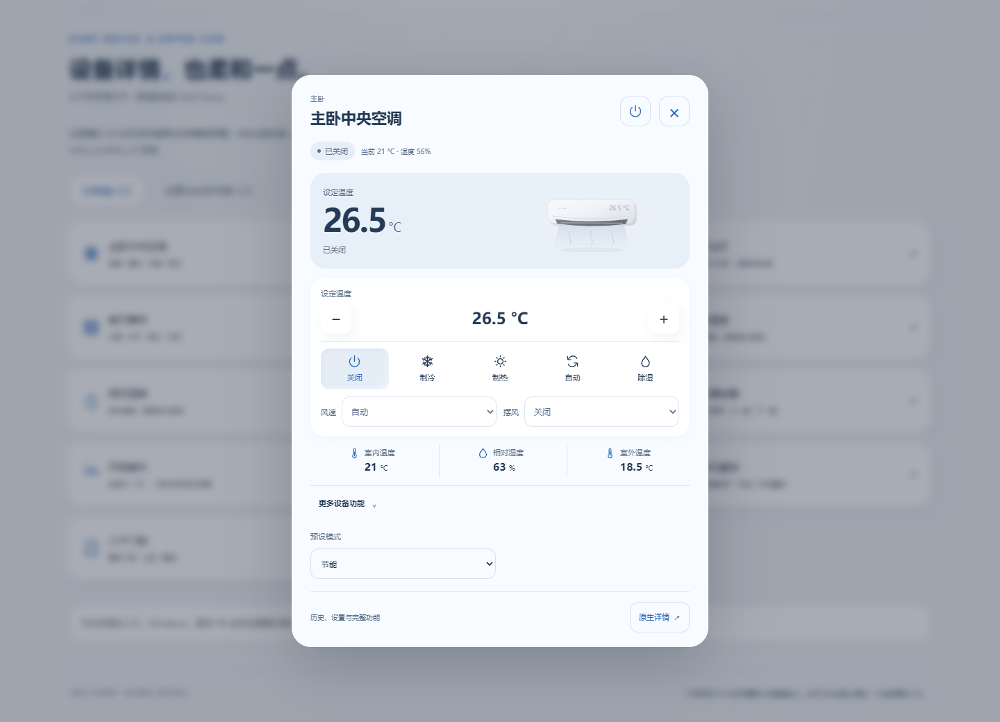

# Soft Home · 全局设备详情

可选前端扩展：将 HA 标准设备详情入口转到 Soft Home 弹窗。从仪表盘、实体列表或设置页面打开同一个实体，使用相同的柔光布局。传感器与事件详情内嵌 HA 原生历史和活动组件；完整历史页、实体设置和其他完整功能通过原生入口继续访问。



[深色预览](more-info-dark-preview.png) · [手机预览](more-info-mobile-preview.png) · [本地交互预览](http://127.0.0.1:8124/demo/more-info.html)

[音乐播放器预览](more-info-music-preview.png)：已补全播放／暂停、上一首／下一首。设备未上报音量值时也能显示支持的播放按钮。

[开锁历史与活动预览](more-info-history-preview.png)：当前值为“无”时，过去的开锁记录仍可查看。本地预览使用示例记录，安装后由 HA 自身的历史与活动组件读取真实数据。

[主灯大吊灯预览](more-info-main-light-preview.png) · [温度变化曲线](more-info-temperature-preview.png) · [湿度变化曲线](more-info-humidity-preview.png)

[童锁预览](more-info-child-lock-preview.png)：设备按键保护使用独立童锁面板，显示“童锁已开启／关闭”和对应操作；真实门锁保留门把手造型。

## 安装到 HA

1. 下载仓库中的 [`dist/soft-home-more-info.js`](../dist/soft-home-more-info.js)。这个文件已内置设备卡片的渲染逻辑，无需 card-mod、browser_mod 或额外图片文件。
2. 在 HA 配置目录的 `www` 下创建 `soft-home` 文件夹，将文件放到：

   ```text
   /config/www/soft-home/soft-home-more-info.js
   ```

   你的文件编辑器如果将配置目录显示为 `homeassistant/`，对应位置就是 `homeassistant/www/soft-home/soft-home-more-info.js`。JS 放在 `www` 下，主题 YAML 继续放在 `themes` 下。
3. 在 `configuration.yaml` 已有的 `frontend:` 中加入 `extra_module_url`。和柔光主题一起使用时，完整示例如下：

   ```yaml
   frontend:
     themes: !include_dir_merge_named themes
     extra_module_url:
       - /local/soft-home/soft-home-more-info.js?v=1.2.4
   ```

   只合并已有配置，不重复添加 `frontend:`。已有其他 `extra_module_url` 项目时，把新地址追加到列表。原主题目录和已有主题加载方式可以保留。
4. 检查 HA 配置后，**重启 HA 一次**，再刷新浏览器或 Companion App。新增全局模块需要重新加载前端配置，`frontend.reload_themes` 只重载主题颜色，不会加载此 JS。
5. 打开任意一个空调实体的普通详情。看到 Soft Home 弹窗后，即可测试温度、模式和设备实际支持的风速／预设参数。点击右上角齿轮可打开 HA 原生详情。

请使用 `extra_module_url` 安装，以便从设置页直接进入时也加载扩展。仅添加仪表盘资源的方式，不能保证每个页面首次打开时已经加载。已有 HACS 设备卡片可以保留，卡片与扩展可独立更新。此扩展目前需要单独复制安装。

更新时替换 JS，将 URL 的缓存版本参数改为 `v=1.2.4`，再重启 HA 并刷新前端。以后更新时使用对应的数字版本。文件可通过 HA 地址 `/local/soft-home/soft-home-more-info.js?v=1.2.4` 检查是否能访问。

## 替换范围

| 实体 | 柔光详情 |
| --- | --- |
| `climate` | 空调／地暖插画、设定温度、实际读数、运行模式、支持的风速与摆风；预设、目标湿度、温度上下限按实体能力显示 |
| `light` | 灯具插画、亮度、支持的色温与颜色；“主灯／吊灯”识别为六灯头大吊灯，壁灯、灯带、射灯等使用对应外观 |
| `cover` | 窗帘／幕布／升降支架；打开、停止、关闭与实际行程；车库门等使用通用面板 |
| `water_heater`、`vacuum` | 热水与清扫的现有 Soft Home 控件 |
| `lock` | 真实门锁使用门把手插画及上锁／解锁；童锁使用按键保护面板及开启／关闭童锁；要求 PIN 时继续使用原生面板 |
| `camera` | 画面内显示状态和实时播放／暂停按钮；播放时显示设备支持的云台控制，完整录像操作进入原生详情 |
| `media_player` | 播放／暂停、上一首／下一首、停止；音量、静音、相对音量、输入源和播放进度按实际能力与读数显示；其他媒体功能进入原生详情 |
| `fan`、`switch`、`input_boolean` | 开关与支持的风速／预设模式 |
| `number`、`input_number`、`select`、`input_select` | 实体上报的数值范围、步长与选项 |
| `button`、`input_button` | 已有可执行按钮 |
| `sensor`、`binary_sensor`、`event` | 读数／事件类型、折叠属性，以及 HA 原生历史图与活动记录 |

控件按实体能力和当前服务生成；离线、未知、断线或只读时限制操作。扩展不创建集成、实体或设备参数，也不会把尚未上报的服务结果当成真实读数。全局打开时按当前实体所属的物理设备匹配已有绑定；从 Soft Home 卡片打开时保留该卡片的绑定与只读配置。

灯具识别会读取实体名称、实体 ID 和设备注册表中的名称。已经在卡片中明确选了「壁灯」，或通过配置指定了外观时，保留该选择；已有主灯卡片需要在编辑器中把设备类型改成「吊灯」，对应 YAML 为 `device: pendant_light`。

童锁根据实体名称、实体 ID、实体注册表名称中的“童锁／儿童锁／child lock／control lock／panel lock／button lock”识别，或使用当前卡片明确绑定的 `washer.child_lock` 实体。设备名称本身不作为童锁依据，避免将同一设备上的真实门锁误判。`lock` 型童锁调用本实体的上锁／解锁服务，`switch` 和 `input_boolean` 型童锁调用本实体的开关服务；关闭时确认文案为“确认关闭童锁？”。`sensor` 和 `binary_sensor` 型童锁只显示状态和历史。离线、只读、服务缺失或状态切换中不提供童锁操作。

完整历史页、设置、携带专门上下文的详情请求，以及安防主机等尚未支持的类型，继续交给 HA 原生流程。第三方页面若没有使用 HA 的标准 `hass-more-info` 事件，也不会被接管。

## 历史与活动

传感器、二进制传感器和事件实体的详情会嵌入 HA 已注册的 `ha-more-info-history-and-logbook` 组件，或兼容的独立历史／活动组件。扩展将当前登录会话和同一个实体 ID 传给它们，历史时间轴、活动列表、时间范围和数据读取沿用 HA 自身的实现与权限，不另建一套记录。

因此，开锁事件当前回到“无”不会导致历史列表被隐藏。`event` 实体显示上报的事件类型，历史仍由原生组件处理。「显示更多」继续打开该实体的原生历史页。组件尚在加载时显示等待提示；如果当前 HA 版本没有提供兼容组件，会明确提示并提供「查看历史与活动」入口，不会用空白或“没有记录”替代加载失败。

温度、湿度等数值传感器由同一原生历史组件显示变化曲线，保留对应实体、数值单位和 HA 的历史查询功能。分别打开温度或湿度实体即可查看各自曲线；需要在 Recorder 中保留这些实体的历史。预览中的温湿度曲线使用本地示例数据，实际安装后显示的内容以 HA 查询结果为准。

真实数据是否存在，仍取决于 HA 的 Recorder／活动日志配置、保留时间及当前账户权限。预览页的历史组件和记录是本地示例，只用于验证接入、状态更新和导航，不能替代目标 HA 版本的实机验证。

## 恢复原生面板

移除 `extra_module_url` 列表中的这一条地址，保留其他配置，重启 HA 并刷新客户端即可。主题 YAML 和已有卡片配置可以继续使用。

临时测试时，也可在当前浏览器控制台执行：

```js
window.softHomeMoreInfo.disable(); // 当前页面恢复原生入口
window.softHomeMoreInfo.enable();  // 当前页面重新启用
```

这些开关只作用于当前页面，刷新后按安装配置加载。需要排除个别实体或类型时，可以在当前页面设置：

```js
window.softHomeMoreInfoConfig = {
  exclude_domains: ["camera"],
  exclude_entities: ["climate.study"],
};
```

## 验证与兼容

使用 HA 标准的 `hass-more-info`／`show-dialog`／`dialog-closed` 接口，通过 HA 的 `provideHass` 获取状态更新；不修改 HA 核心文件或替换原生组件定义。浏览器返回键由 HA 弹窗管理器处理，Esc、点击背景和关闭按钮同样可关闭弹窗。

已经通过 61 项单元测试和 23 项全局弹窗浏览器检查，覆盖童锁与门锁区分、主灯及具体灯具识别、温湿度历史图接入、不同页面入口、真实控件命令、状态更新、原生回退、重复加载、离线／只读、错误提示与手机布局。童锁回归覆盖锁与开关两种实体、操作目标、关闭确认、只读与 PIN 回退，以及真实门锁原有外观和解锁确认。媒体回归用例复现 `supported_features: 16447` 且没有音量读数的暂停状态。历史回归覆盖当前值为“无”的开锁传感器、事件实体、组件延迟注册、切换实体、旧版独立组件与组件缺失时的原生回退。浏览器检查使用本地 HA 接口模拟，未在你的 HA 实例上实机验证；HA 前端接口变化后仍需按版本复核。

开发验证：`npm run build`、`npm run check`、`npm test`、`npm run test:more-info`。本地预览运行 `npm run demo` 后打开 `/demo/more-info.html`，可在「仪表盘入口」和「设置与实体列表入口」中分别打开设备。
