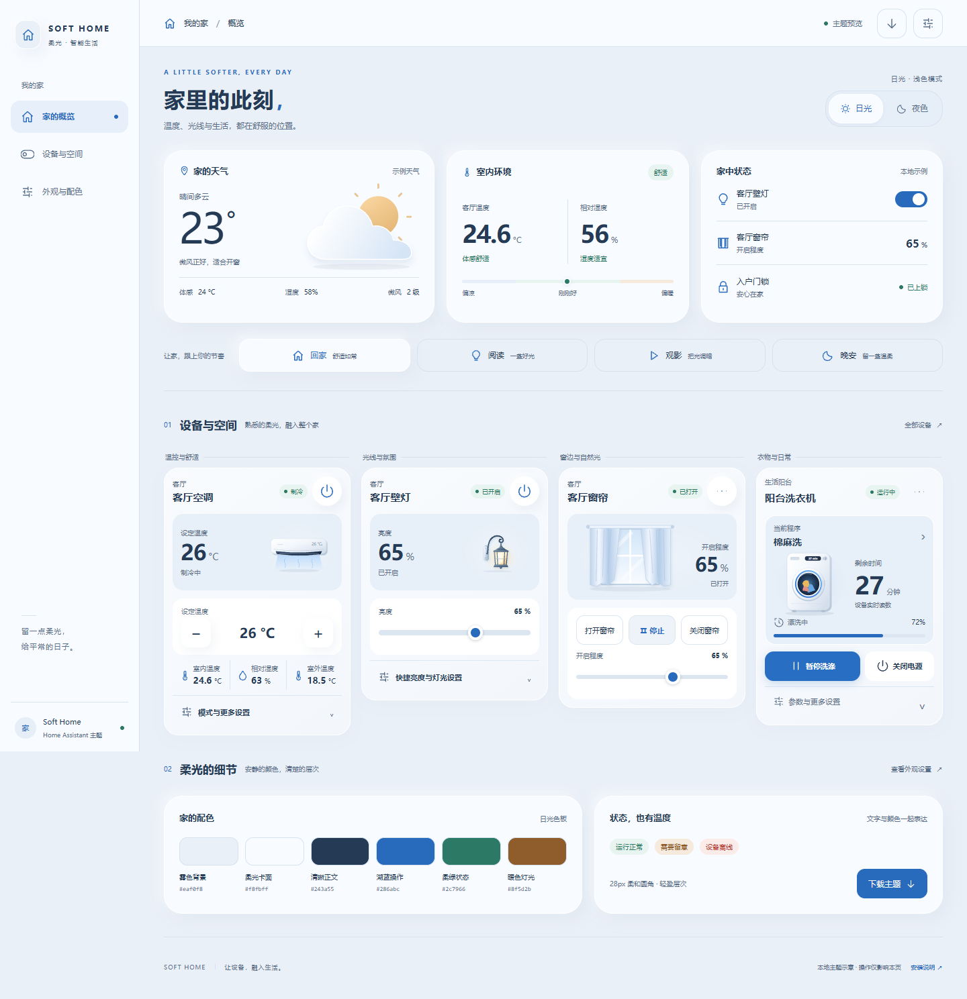
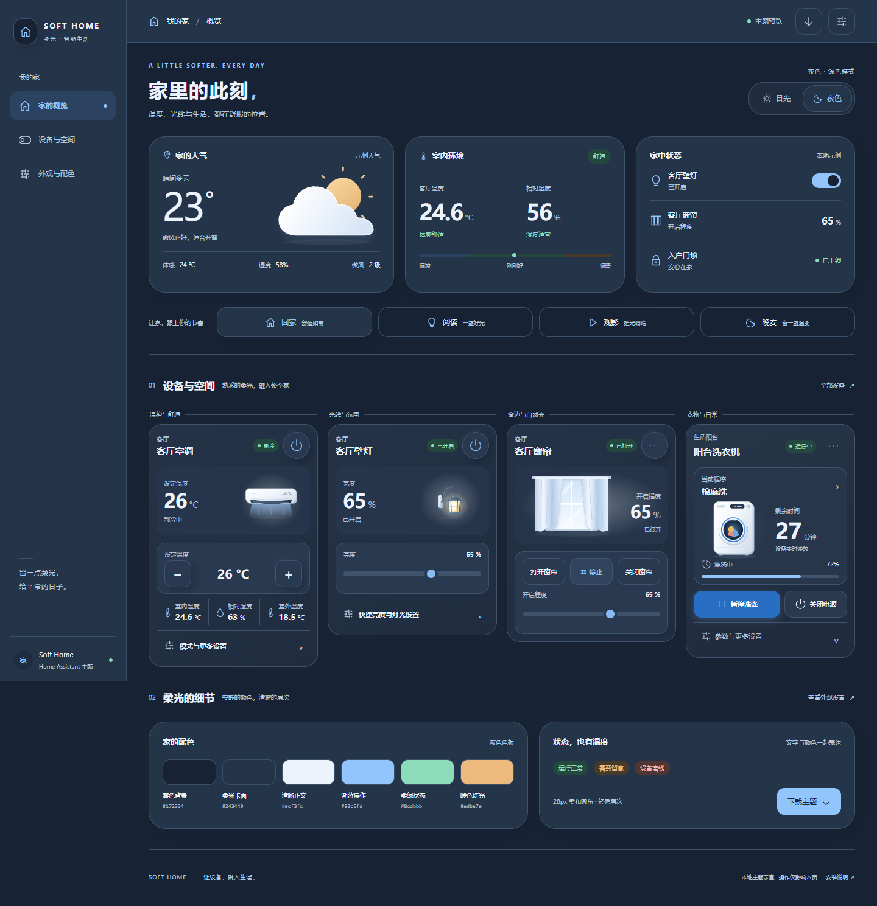

# Soft Home · 柔光主题

延续现有设备卡片的浅蓝白柔光风格，包含日光和夜色两种模式。全局背景、导航、原生卡片、表单、弹窗、状态颜色与设备卡片配套；只需一份 YAML，无需 card-mod、Mushroom 或在线字体。





[查看手机布局预览](../docs/theme-mobile-preview.png)

## 安装

1. 将本目录的 `soft_home.yaml` 复制到 HA 的 `/config/themes/soft_home.yaml`。没有 `themes` 目录时先创建。
2. 在 `/config/configuration.yaml` 中启用主题目录：

   ```yaml
   frontend:
     themes: !include_dir_merge_named themes
   ```

   已有 `frontend:` 时，只合并其中的 `themes:`，不要再添加第二个同名配置项。如果原来已配置主题文件或目录，保留原有主题，将 Soft Home 加入原有加载方式。
3. 首次新增或修改 `frontend` 配置时，先检查配置，再重启 HA。已经启用相同主题目录时，在「开发者工具 → 动作」执行 `frontend.reload_themes` 即可。
4. 打开左下角个人资料，在浏览器的主题设置中选择 **Soft Home**。配色模式选择浅色、深色或自动（具体名称随 HA 版本和语言略有差异）。每台浏览器／Companion App 可以分别设置。

卡片通过 HACS 安装时，主题仍需单独复制；Dashboard 类型的 HACS 仓库不会自动安装这里的主题。更新 YAML 后执行 `frontend.reload_themes`，必要时重新选择主题或刷新前端。

## 和设备卡片一起使用

Soft Home 卡片选择「跟随系统」主题，或在卡片 YAML 中设置：

```yaml
type: custom:soft-home-card
device: air_conditioner
entity: climate.replace_with_your_ac
theme: auto
```

已有卡片固定为 `theme: light` 或 `theme: dark` 时，会保持固定模式。卡片使用自身的配色与插画，本主题协调的是 HA 全局界面；修改主题中的颜色不会自动改写卡片内部的专属配色。

## 设计与范围

| 元素 | 日光 | 夜色 |
| --- | --- | --- |
| 页面 | 雾蓝 `#eaf0f8` | 深蓝灰 `#172334` |
| 卡面 | 雪白 `#f8fbff` | 蓝灰 `#243449` |
| 正文 | 蓝墨 `#243a55` | 冰白 `#ecf3fc` |
| 操作 | 湖蓝 `#286abc` | 浅蓝 `#93c5fd` |
| 运行／正常 | 柔绿 `#2c7966` | 薄荷绿 `#8cdbbb` |
| 灯光／加热 | 琥珀 `#8f5d2b` | 暖杏 `#edba7e` |

卡片采用 28px 圆角、细边框和轻柔双向阴影。控件圆角按层级区分。字体使用本机中文字体和系统字体，不发起外部字体请求。异常仍保留清晰的红色语义。

主题包含经典 HA 变量与当前前端的 `ha-color-*` 语义变量。不同 HA 版本和第三方卡片采用的变量不同，实际界面以所安装版本为准。主题仅控制支持主题变量的颜色、字体和形状，不改变仪表盘布局，不生成天气、场景或设备实体。

若要将原生空调详情中的圆盘和按钮布局也换成 Soft Home，可额外安装 [全局设备详情扩展](../docs/more-info.md)。这需要单独的 JS 与 `extra_module_url` 配置。

## 本地预览

在仓库根目录运行 `npm run demo`，打开 [主题预览](http://127.0.0.1:8124/demo/theme.html)。可切换深浅模式、调整示例设备、选择场景和查看外观弹窗。示例数据和操作均在本地，不连接或控制真实家庭设备。

预览中的导航、天气和原生样式组件是 HTML 示意，设备卡片使用本仓库实际组件。安装 YAML 后不会自动得到预览中的页面排版。设计规范见 [DESIGN.md](../DESIGN.md)。
